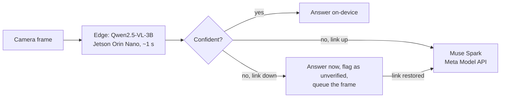
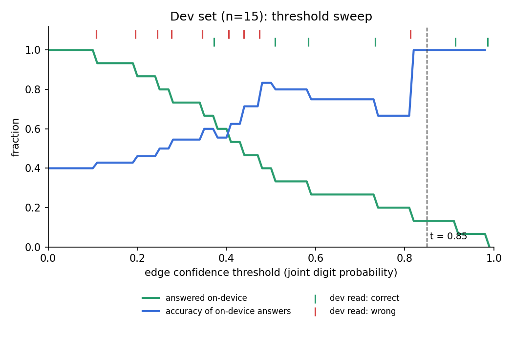

# Zero-Training Edge Recognition

**A field robot's camera that knows when it doesn't know.**

Robots in warehouses, plants and the field have to read things: part tags, shipping labels, bin and location codes, sample markers. They also lose their network connection. This project is an edge-to-cloud router for that job. A 3B vision-language model on an 8 GB Jetson Orin Nano reads the image, scores how sure it is from its own token probabilities, and only calls the cloud (Meta's Muse Spark) when it isn't sure. With no connection, it still answers immediately, flags the unsure answers, and queues them for verification once the link comes back: *read now, ask later*.

No training and no fine-tuning: a threshold on the model's own confidence decides everything, and for the benchmark that threshold was picked once on a small dev set and then frozen.

> Built solo for the Meta Global AI Developer Hackathon (indie track), Oct–Nov 2026.

---

## How it works



**The confidence signal.** The model writes its answer one token at a time and assigns a probability to each token before choosing it. llama.cpp exposes those probabilities (`logprobs`), so confidence costs nothing extra: no second model, no second pass, no training. For short numbers the router uses the joint probability of the digits (threshold 0.85). For long codes, where a joint probability shrinks with length, it uses the weakest single character (threshold 0.90).

**Any task, one router.** The same router reads numbers and reads labels and tags; only the prompt changes. Anyone can ask their own question: pick **Custom…** on the dashboard and type a prompt, or pass `--prompt` to `feed.py`. Custom prompts live in memory until the server stops. They use the weakest-token signal with a threshold of 0.90 that is **uncalibrated**: no dev set chose it, so their on-device answers carry no tested accuracy, and the dashboard marks them that way. Short answers (a number, a code, a word) route best; free-text answers mostly go to Muse Spark, because token confidence can't check free text.

---

## Reading labels and tags

The task a field robot actually faces: tracking numbers, part numbers, bin and location codes, postal codes. Tested on 9 openly licensed photos (Pexels) of shipping labels, an inspection tag on steel beams and warehouse bin labels, with the labels and rubric committed before any run ([`data/labels/RUBRIC.md`](data/labels/RUBRIC.md)).

| | Result (n = 9) |
| --- | --- |
| Edge model alone | 2/9 correct |
| Answers the edge kept as confident | **0**, so **0 confident errors** |
| After sync with Muse Spark | **8/9** |

The 3B on-device model can't reliably read long, dense codes, and **it knows it**: every label answer scored far below the threshold, so nothing wrong was ever reported as confident. Offline, the robot still captures and flags each label; when the link returns, Muse Spark reads them.

Follow-up experiments (exploratory, on the same images, reported separately) pinned down the limit:

- a 4× larger image budget made the edge worse, not better;
- a rewritten prompt didn't change accuracy, though it replaced a canned placeholder answer (`1234567890`) with partial reads of the real code;
- cropping to the label first (Qwen locates it, SAM 2.1 segments it) lowered accuracy;
- with SAM 3.1 finding the label in all 9 images, the edge read the three short codes correctly (a location code, a ZIP code, a postcode) and still failed every long one.

So the bottleneck is reading long alphanumeric strings, not finding them. **Short codes are within the edge model's reach; long ones go to the cloud.** Across every variant tried, the edge never kept a wrong label answer.

**Scene captions** (exploratory): asked for structured output (the code plus a one-line caption), the edge described clear scenes usefully (13 of 27 pre-listed facts, with 2 false statements) against Muse Spark's 25 of 27 with none. Captions are shown as unverified and never used for routing, because token confidence can't check free text.

---

## Benchmark: how well does the router decide?

To measure the routing decision itself, you need many real photos with an unambiguous right answer, varied difficulty and clear licensing. **Jersey numbers are used purely as that test set**: short printed numbers on real, often blurry or angled photos, the same shape of problem as a part number on a moving machine. The product is the router, not a sports tool.

Held-out set: 25 openly licensed Wikimedia Commons photos, never seen during development. The threshold was chosen on a separate dev set by a rule committed before any data was read, then frozen.

| Pipeline | Correct | Answered on-device | Cloud calls |
| --- | --- | --- | --- |
| **Confidence router** (edge, then Muse Spark if unsure) | **23/25 (92%)** | 3 | 22 |
| Edge alone (Qwen2.5-VL-3B on the Jetson) | 12/25 (48%) | 25 | 0 |
| Muse Spark alone, full image (cloud) | 22/25 | 0 | 25 |
| SAM 3.1 crop → Muse Spark (cloud) | 22/25 | 0 | 48 |
| SAM 3.1 crop → edge read | 14/25 | — | 25 (SAM) |

- **The router's accuracy is in line with sending every frame to the cloud**, while answering some frames on-device and staying usable offline. The edge model alone is far less accurate; the point is that it knows which of its answers to trust.
- **12 of the edge's 13 errors scored below the threshold** and were sent to the cloud. One was not: `wm_036`, read as "3" at 0.881 (threshold 0.85), the router's only confident error.
- Images with two equally prominent numbers list both as correct answers, decided by a size rule before any run ([`data/own/RUBRIC.md`](data/own/RUBRIC.md)). Counting only the largest number: router 22/25, edge 10/25.
- Muse Spark is not deterministic: the cloud-only rows come from a separate run, and Muse's answers on the same images varied between runs (see [Limits](#limits)).

### Offline mode and sync

Same 25 images, link cut:

| | Result |
| --- | --- |
| Offline (edge only) | 12/25 correct, ~1.0 s per frame, no network |
| Flagged as unverified and queued | 22 frames |
| After the link returns and the queue syncs | **23/25** (11 edge errors fixed), 5.46 MB uploaded |

### Threshold selection (dev set, n = 15)



Rule ([`benchmark/select_threshold.py`](benchmark/select_threshold.py)): the smallest value in `[0.50, 0.60, 0.70, 0.80, 0.85, 0.90, 0.95, 0.98, 0.99]` at which every answer the edge would keep on dev is correct. It selected **0.85** (set by one dev image read wrongly at 0.813), written to [`config/threshold.json`](config/threshold.json) and committed before the single held-out run.

---

## Evaluation method

- **Data you can check.** 40 jersey photos from Wikimedia Commons under CC0, CC BY, CC BY-SA or public domain ([`data/own/ATTRIBUTION.md`](data/own/ATTRIBUTION.md)) and 9 label photos from Pexels. An early prototype used web images whose license didn't allow evaluation use; they were removed from the repo history and none of their results are reported.
- **Rules before results.** Rubrics, labels and splits were committed before any model saw the images.
- **No hand-picking.** A seeded, difficulty-stratified split ([`scripts/build_manifests.py`](scripts/build_manifests.py), seed `20261101`): 15 dev, 25 held-out, deliberately hard-weighted (9 easy, 15 medium, 16 hard).
- **One shot at the held-out set.** The threshold was committed before the held-out run and not tuned afterwards. Every number here comes from a committed file in [`results/`](results/).

---

## Segmentation: what was tried

The original design put Meta's Segment Anything in front of the reader. The shipped router has no segmentation, and here is why.

| Model | Where | Outcome |
| --- | --- | --- |
| SAM 2.1 | On the Jetson | Evaluated in segment-then-read and agreement cascades; dropped. On labels it reduced accuracy. |
| SAM 3 (841M) | On the Jetson | **Runs on-device**: ~1.2–1.4 s per image, ~4 GB peak GPU memory, with randomly initialized weights while access to the gated weights is pending. A feasibility result only: accuracy can't be measured without the real weights. Can't run alongside the reader at full GPU offload, so it would need a load/unload design. Notes: [`experiments/sam3_local/NOTES.md`](experiments/sam3_local/NOTES.md). |
| SAM 3.1 | Meta Model API (cloud) | Measured in the benchmark table: its crops gave the edge a small lift (12 → 14 of 25) and found nothing in 2 of 25 images. On labels it found every label. |

Cloud SAM 3.1 results describe the cloud model only; they are not an estimate of how SAM 3 would score on the device.

---

## Jetson engineering

Hardware: Jetson Orin Nano Super Developer Kit, 8 GB. Edge model: `Qwen2.5-VL-3B-Instruct-q4_k_m.gguf` (1.93 GB) with `Qwen2.5-VL-3B-Instruct-mmproj-q8_0.gguf` (845 MB), served by llama.cpp (commit `97e4ca735`).

**The memory problem.** The board kept failing to allocate GPU memory when loading the model. On Jetson, GPU allocations come from system RAM through the `nvmap` allocator, and loading a 2.6 GB model through the page cache left too little free memory for them. (Earlier notes in this project blamed the CMA pool; that diagnosis was wrong.) The fix:

- `-lm dio`: load the model with direct I/O so it doesn't fill the page cache;
- a startup guard that refuses to start below 4.5 GB `MemAvailable`, with `sync && sudo sysctl -w vm.drop_caches=3` as the remedy;
- with memory under control, all layers on the GPU: `-ngl 99` with `GGML_CUDA_ENABLE_UNIFIED_MEMORY=1`.

**Speed.** Nsight Systems/Compute profiling of the baseline, done before the hackathon, showed decoding dominated by a memory-bound Q4_K matmul kernel. During the hackathon, the memory problem above first forced the vision encoder onto the CPU, which made reads far slower; with a larger physical batch (`-ub 512`) the encoder fits back on the GPU, and after the memory fix all layers run there. With an equalized 256-image-token budget per read, the result is **~1.0 s per edge read**; mean routed latency is ~4.0 s, dominated by cloud calls.

---

## Meta models used

- **Muse Spark** (`muse-spark-1.3`, Meta Model API): the cloud tier, in the live path for every low-confidence frame and every queued frame on sync.
- **SAM 3.1** (`sam-3.1`, Meta Model API): evaluated as cloud-side localization.
- **SAM 3** (openly released weights under the SAM License; gated download): built and run on the Jetson for feasibility; real weights pending access approval.
- **SAM 2.1** (open weights): evaluated on the Jetson in the segmentation cascades.

---

## Run it

**Hardware.** A Jetson Orin Nano (8 GB) on JetPack 6.

**llama.cpp**, built with CUDA for the Orin's GPU (compute capability 8.7), at the commit used for every result here:

```bash
git clone https://github.com/ggml-org/llama.cpp && cd llama.cpp && git checkout 97e4ca735
cmake -B build -DGGML_CUDA=ON -DCMAKE_CUDA_ARCHITECTURES=87 -DCMAKE_BUILD_TYPE=Release
cmake --build build --config Release -j 6 --target llama-server
```

**Model files.** `Qwen2.5-VL-3B-Instruct-q4_k_m.gguf` and `Qwen2.5-VL-3B-Instruct-mmproj-q8_0.gguf` (Qwen2.5-VL-3B-Instruct, 4-bit weights with an 8-bit vision projector). Set their paths, and the `llama-server` path, at the top of [`benchmark/run_benchmark.py`](benchmark/run_benchmark.py) (`LLAMA_SERVER`, `VLM_MODEL`, `VLM_MMPROJ`).

Any GGUF conversion of Qwen2.5-VL-3B-Instruct at these quantizations should run; other quantizations or conversions can shift confidence values slightly. To check you have the exact files behind the published numbers:

```text
1c25a45390fe6e5e15365ec57ffb115d27edc2360eb8fe6da8069b000055ed3e  Qwen2.5-VL-3B-Instruct-q4_k_m.gguf
e0a8927b2c27819d5958915a4903b11f16c60dc1a5c6f3ec74cb0be106419942  Qwen2.5-VL-3B-Instruct-mmproj-q8_0.gguf
```

**Python.** Python 3.10, then:

```bash
pip install -r requirements.txt
```

**Meta Model API key** (only the cloud tier needs it):

```bash
cp .env.example .env      # then put your key in .env as MODEL_API_KEY=...
```

Offline mode, and every committed result, works without a key.

**The live demo** (the dashboard shown in the video):

```bash
sync && sudo sysctl -w vm.drop_caches=3          # if MemAvailable < 4.5 GB
uvicorn server.app:app --host 0.0.0.0 --port 8000

# in a second terminal: feed images like a camera would
python server/feed.py data/labels/images/ --task label --manifest data/labels/labels.csv --delay 2
python server/feed.py data/own/images/ --manifest data/own/heldout.json --delay 2
```

Open `http://<jetson-ip>:8000` (or tunnel: `ssh -N -q -L 8000:localhost:8000 <jetson>`). Each frame shows the answer, a confidence bar against the threshold, and where the answer came from: ON-DEVICE, MUSE SPARK, QUEUED, or QUEUED → MUSE SPARK after sync. **Cut link** simulates an outage and **Sync queue** verifies the queued frames. Click any row to view its frame; scroll to zoom (sharp up to the photo's actual pixels), drag to pan, and **Expand** for a wider view. Drop in your own image and pick a task, or choose **Custom…** to ask your own question. From the command line: `python server/feed.py img.jpg --prompt "Read the number on the gauge. Reply with only the number."`

**Reproduce the numbers:**

```bash
# benchmark: routed run on the held-out set
python router/route.py --manifest data/own/heldout.json --image-dir data/own/images

# offline, then sync
python router/route.py --clear-queue
python router/route.py --manifest data/own/heldout.json --image-dir data/own/images --max-tier 1
python router/route.py --sync

# re-derive the threshold from the dev set (pre-registered rule)
python benchmark/select_threshold.py --manifest data/own/dev.json --image-dir data/own/images

# labels and tags; cloud comparisons
python benchmark/label_test.py
python benchmark/cloud_sam_test.py --set jerseys
```

---

## Limits

- **Small, hard-weighted test sets.** 25 held-out benchmark images and 9 label images. Treat the numbers as evidence of behavior, not precise rates.
- **The edge can't read long codes.** Tracking numbers and long part codes are beyond the 3B model at any crop or resolution tried; in practice those always go to the cloud.
- **One confident error, and a close call.** `wm_036` was kept at 0.881. At the earlier default of 0.90 it would have gone to the cloud; the threshold was not changed after seeing held-out results.
- **Dropped digits.** The edge sometimes outputs only the first digit of a two-digit number. Confidence can only score digits the model wrote, so it can't flag a digit that's missing.
- **Modest cloud savings on these sets.** Because the sets are hard, most frames still went to the cloud. The offline behavior is the stronger benefit.
- **Custom prompts are uncalibrated.** Only the jersey threshold was chosen on a dev set; the label threshold was fixed in advance and tested on 9 images; custom prompts use a default.
- **The cloud tier is good, not perfect.** Muse Spark gave different answers to the same images across runs, and the router has no way to check cloud answers.
- **License.** Qwen2.5-VL-3B is licensed for research and evaluation only (non-commercial).

---

## Related work

- **Agreement-based cascades** (Kolawole, Dennis, Talwalkar and Smith, CMU, TMLR 2025): route between models based on whether cheap models agree.
- **Edge-to-server VLM collaboration** (Song and Kim, POSTECH): escalate from an edge VLM to a server based on the edge model's own uncertainty.
- **Onboard autonomy under constrained links** (NASA JPL's AEGIS, Estlin et al. 2010): Mars rovers select science targets themselves because waiting on Earth is the bottleneck.

What this project adds: a working, training-free edge-to-cloud router on a real 8 GB device, an offline mode that answers immediately and verifies later, the same router across two reading tasks, and an evaluation with thresholds and rubrics fixed before testing.

---

## Future work

- Run SAM 3 on the Jetson with the real weights and measure accuracy, not just speed.
- A stronger on-device reader for long codes, or a dedicated OCR stage, behind the same confidence router.
- A check for dropped digits (e.g. send single-digit answers to the cloud when a longer number is expected), tested on dev only.
- A synthetic blur and angle sweep to map where the edge degrades and whether confidence tracks it.
- A small fleet: several robots sharing one sync server (k3s on a Raspberry Pi plus Jetson), and a Dockerfile.

---

## About this project

**Built during the hackathon (Oct 26 – Nov 4, 2026):** this repository and everything in it: the confidence router and its token-probability signal, the pre-registered evaluation on licensed data, offline mode and sync, the live dashboard with label and custom tasks, and every experiment in this README. **Before it:** the device environment (JetPack, a llama.cpp build serving Qwen2.5-VL-3B, and a SAM 2.1 install) and an Nsight profile of that baseline, from an earlier project. The memory fix, the vision-encoder speedup and everything listed above were done during the hackathon.

Solo project. Built with AI assistance (Anthropic's Claude) for code drafting, debugging, research and writing. The design decisions, data collection and labeling, and every experiment were run, checked and committed by the author on the device.

---

## Credits and licenses

- **Qwen2.5-VL-3B-Instruct**: Qwen is licensed under the Qwen RESEARCH LICENSE AGREEMENT, Copyright (c) Alibaba Cloud. All Rights Reserved. Used here for research and evaluation.
- **llama.cpp**: MIT License.
- **SAM 2.1**: Apache 2.0. **SAM 3**: SAM License (Meta).
- **Muse Spark and SAM 3.1**: accessed through the Meta Model API under its terms.
- **Images**: Wikimedia Commons, per [`data/own/ATTRIBUTION.md`](data/own/ATTRIBUTION.md); Pexels (Pexels License), credited in [`data/labels/RUBRIC.md`](data/labels/RUBRIC.md). Images were downloaded at reduced resolution and converted to JPEG where needed; no other edits except one crop noted in the rubric. Inclusion does not imply endorsement by the photographers or the people pictured.
