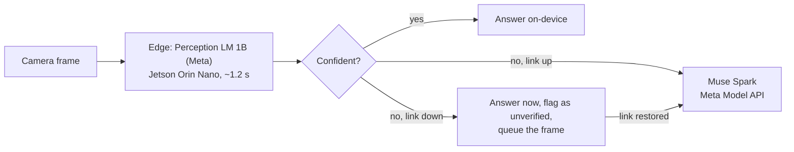
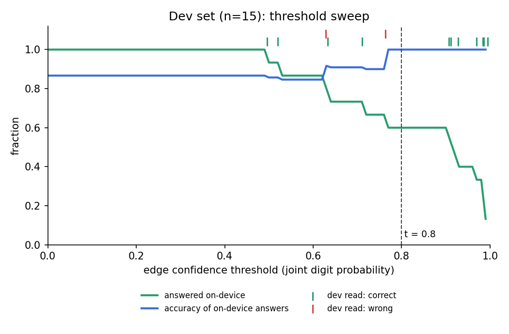

# Zero-Training Edge Recognition

**A field robot's camera that knows when it doesn't know.**

Robots in warehouses, plants and the field have to read things: part tags, shipping labels, bin and location codes, sample markers. They also lose their network connection. This project is an edge-to-cloud router for that job. Meta's **Perception LM 1B** runs on an 8 GB Jetson Orin Nano, reads the image, scores how sure it is from its own token probabilities, and only calls the cloud (Meta's **Muse Spark**) when it isn't sure. With no connection, it still answers immediately, flags the unsure answers, and queues them for verification once the link comes back: *read now, ask later*.

No training and no fine-tuning: a threshold on the model's own confidence decides everything, and for the benchmark that threshold was picked once on a small dev set and then frozen.

> Built solo for the Meta Global AI Developer Hackathon (indie track), Oct–Nov 2026.

---

## How it works



**The confidence signal.** The model writes its answer one token at a time and assigns a probability to each token before choosing it. Those probabilities come out of the same forward pass that produces the answer, so confidence costs nothing extra: no second model, no second pass, no training. For short numbers the router uses the joint probability of the digits (threshold **0.80**, chosen on the dev set). For long codes, where a joint probability shrinks with length, it uses the weakest single token (threshold 0.90, fixed in advance).

**Any task, one router.** The same router reads numbers and reads labels and tags; only the prompt changes. Anyone can ask their own question: pick **Custom…** on the dashboard and type a prompt, or pass `--prompt` to `feed.py`. Custom prompts live in memory until the server stops. They use the weakest-token signal with a threshold of 0.90 that is **uncalibrated**: no dev set chose it, so their on-device answers carry no tested accuracy, and the dashboard marks them that way. Short answers (a number, a code, a word) route best; free-text answers mostly go to Muse Spark, because token confidence can't check free text.

---

## Benchmark: how well does the router decide?

To measure the routing decision itself, you need many real photos with an unambiguous right answer, varied difficulty and clear licensing. **Jersey numbers are used purely as that test set**: short printed numbers on real, often blurry or angled photos, the same shape of problem as a part number on a moving machine. The product is the router, not a sports tool.

Held-out set: 25 openly licensed Wikimedia Commons photos, never seen during development. The threshold was chosen on a separate dev set by a rule committed before any data was read, then frozen.

| Pipeline | Correct | Answered on-device | Cloud calls |
| --- | --- | --- | --- |
| **Confidence router** (edge, then Muse Spark if unsure) | **24/25 (96%)** | **11** | 14 |
| Edge alone (Perception LM 1B on the Jetson) | 22/25 (88%) | 25 | 0 |
| Muse Spark alone, full image (cloud) | 22/25 | 0 | 25 |
| SAM 3.1 crop → Muse Spark (cloud) | 22/25 | 0 | 48 |

- **The router matches or beats sending every frame to the cloud, while answering 11 of 25 frames on-device** (~1.2 s each) and staying usable offline.
- **2 of the edge's 3 errors scored far below the threshold** (0.165 and 0.391) and went to the cloud. One did not: `wm_027`, read as "14" at 0.908 (truth 40), the router's only confident error.
- **14 of the 14 frames sent to Muse Spark came back correct.** 12 of those 14 were already right on the edge (several just under the threshold, e.g. 0.799 and 0.780): the dev-set rule is conservative by design.
- Images with two equally prominent numbers list both as correct answers, decided by a size rule before any run ([`data/own/RUBRIC.md`](data/own/RUBRIC.md)).
- The cloud-only rows come from a separate run (Nov 2) and involve no edge model. Muse Spark is not deterministic: its answers on the same images varied between runs (see [Limits](#limits)).

Results: [`results/route_20261103_052030.json`](results/route_20261103_052030.json).

### Offline mode and sync

Same 25 images, link cut:

| | Result |
| --- | --- |
| Offline (edge only) | **22/25 correct**, ~1.2 s per frame, no network |
| Flagged as unverified and queued | 14 frames (12 of them already correct) |
| After the link returns and the queue syncs | **23/25**: 2 edge errors fixed, 1 correct edge answer overwritten by Muse (`wm_014`, "14" → "0"); 3.70 MB uploaded |

Results: [`results/route_20261103_052242.json`](results/route_20261103_052242.json), [`results/sync_heldout_20261103.jsonl`](results/sync_heldout_20261103.jsonl).

### Threshold selection (dev set, n = 15)



Rule ([`benchmark/select_threshold.py`](benchmark/select_threshold.py)): the smallest value in `[0.50, 0.60, 0.70, 0.80, 0.85, 0.90, 0.95, 0.98, 0.99]` at which every answer the edge would keep on dev is correct. On dev the edge read 13/15 correctly; the rule selected **0.80** (set by one dev image read wrongly at 0.763), keeping 9 of 15 frames on-device, all 9 correct. It was written to [`config/threshold.json`](config/threshold.json) and committed before the single held-out run.

---

## Reading labels and tags

The task a field robot actually faces: tracking numbers, part numbers, bin and location codes, postal codes. Tested on 9 openly licensed photos (Pexels) of shipping labels, an inspection tag on steel beams and warehouse bin labels, with the labels and rubric committed before any run ([`data/labels/RUBRIC.md`](data/labels/RUBRIC.md)).

| Pre-registered run (n = 9) | Result |
| --- | --- |
| Edge model alone | **0/9** |
| Answers the edge kept as confident | **0**, so **0 confident errors** |
| After sync with Muse Spark | **7/9** |

With the pre-registered prompt, which lists the kinds of identifier to look for, the 1B model answered with the **kind** ("PART NUMBER", "TRACKING NUMBER") instead of the value. Every one of those answers scored far below the threshold (weakest token 0.18–0.46), so nothing wrong was reported as confident.

**Exploratory follow-up** (prompt chosen after seeing that run, same 9 images, reported separately): asking for "only the characters of the code, exactly as printed", the edge read **3 of 9 values** correctly (a barcode, a part number, a postal code), with near misses on others and garbage on the long tracking labels. All answers still scored below 0.90, so none were kept; the garbage reads scored lowest of all (0.02–0.04). A larger image (8 tiles instead of 4) did not help (2/9).

So **on-device, Perception LM 1B reads jersey numbers reliably but long label codes only partly; labels mostly need the cloud.** Offline, the robot still keeps its best guess for every label, flagged as unverified, until it can sync. Across every variant, the edge never kept a wrong label answer.

---

## Evaluation method

- **Data you can check.** 40 jersey photos from Wikimedia Commons under CC0, CC BY, CC BY-SA or public domain ([`data/own/ATTRIBUTION.md`](data/own/ATTRIBUTION.md)) and 9 label photos from Pexels. An early prototype used web images whose license didn't allow evaluation use; they were removed from the repo history and none of their results are reported.
- **Rules before results.** Rubrics, labels and splits were committed before any model saw the images.
- **No hand-picking.** A seeded, difficulty-stratified split ([`scripts/build_manifests.py`](scripts/build_manifests.py), seed `20261101`): 15 dev, 25 held-out, deliberately hard-weighted (9 easy, 15 medium, 16 hard).
- **One shot at the held-out set.** The threshold was committed before the held-out run and not tuned afterwards. Every number here comes from a committed file in [`results/`](results/), and the commit history shows the order.

---

## Segmentation: what was tried

The original design put Meta's Segment Anything in front of the reader. The shipped router has no segmentation, and here is why.

| Model | Where | Outcome |
| --- | --- | --- |
| SAM 2.1 | On the Jetson | Evaluated in segment-then-read cascades with the earlier edge model (see [Earlier comparison](#earlier-comparison-a-non-meta-edge-model)); cropping lowered reading accuracy on jerseys and labels, so it was dropped. |
| SAM 3 (841M) | On the Jetson | **Runs on-device**: ~1.2–1.4 s per image, ~4 GB peak GPU memory, with randomly initialized weights while access to the gated weights is pending. A feasibility result only: accuracy can't be measured without the real weights. With the reader's ~3.1 GB it doesn't fit in 8 GB at the same time, so it would need a load/unload design. Notes: [`experiments/sam3_local/NOTES.md`](experiments/sam3_local/NOTES.md). |
| SAM 3.1 | Meta Model API (cloud) | As cloud-side localization: found a jersey number in 23 of 25 held-out images and every label in the label set; SAM 3.1 crop → Muse Spark scored 22/25 on jerseys. |

Cloud SAM 3.1 results describe the cloud model only; they are not an estimate of how SAM 3 would score on the device.

---

## Jetson engineering

Hardware: Jetson Orin Nano Super Developer Kit, 8 GB (CPU and GPU share the same memory). Edge model: [`facebook/Perception-LM-1B`](https://huggingface.co/facebook/Perception-LM-1B) at commit `2b1a854`, ~1.5B parameters, bf16, run in-process with Hugging Face transformers ([`router/edge_model.py`](router/edge_model.py)). Weights SHA-256: `bc606ce0cf9fcbcd9b5b133d017cb46abb088877cb28aac6382369faab5926f8`.

**The memory problem.** On Jetson, GPU allocations come from system RAM through the `nvmap` allocator, and they fail (`NvMap … error 12`) rather than evict the page cache. (Earlier notes in this project blamed the CMA pool; that diagnosis was wrong.) Two things made the model load and run reliably:

- **Load straight onto the GPU** (`device_map="cuda"`). Loading on the CPU and then moving to the GPU briefly holds two copies of the weights in the shared 8 GB and fails.
- **Evict the weights file from the page cache after loading** (`posix_fadvise(DONTNEED)`). The ~3 GB of cached file pages otherwise block later GPU allocations even though `free` counts them as available. With this, no manual `drop_caches` is needed between runs.

A startup guard still refuses to start below 3.5 GB `MemAvailable`, with `sync && sudo sysctl -w vm.drop_caches=3` as the remedy.

**Speed and memory.** Each frame is tiled by the model's own processor (4 tiles of 448 px, 1,347 input tokens). Warm reads take **~1.2 s** at ~3.1 GB peak GPU memory; the first read after loading takes ~4 s, and loading takes ~9 s. Mean routed latency on the held-out set is ~4.2 s, dominated by cloud calls.

---

## Meta models used

- **Perception LM 1B** (`facebook/Perception-LM-1B`, FAIR Noncommercial Research License): the on-device reader and the source of the confidence signal, in the live path for every frame. Runs on the Jetson.
- **Muse Spark** (`muse-spark-1.3`, Meta Model API): the cloud tier, in the live path for every low-confidence frame and every queued frame on sync.
- **SAM 3.1** (`sam-3.1`, Meta Model API): evaluated as cloud-side localization.
- **SAM 3** (openly released weights under the SAM License; gated download): built and run on the Jetson for feasibility; real weights pending access approval.
- **SAM 2.1** (open weights): evaluated on the Jetson in the segmentation cascades.

---

## Run it

**Hardware.** A Jetson Orin Nano (8 GB) on JetPack 6.

**Python 3.10 with CUDA PyTorch.** pip's default aarch64 wheel is CPU-only, so install PyTorch from the Jetson AI Lab index for JetPack 6 first (this project used torch 2.11.0 with CUDA 12.6), then the rest:

```bash
pip install torch torchvision --index-url https://pypi.jetson-ai-lab.io/jp6/cu126
```

Then:

```bash
pip install -r requirements.txt
```

**The model** is gated on Hugging Face: request access at [`facebook/Perception-LM-1B`](https://huggingface.co/facebook/Perception-LM-1B), then log in on the device. It downloads (~3 GB) on first run, pinned to commit `2b1a854`.

```bash
export HF_HOME=/path/with/space      # optional: keep the download off a small boot drive
hf auth login                        # a Read token is enough
```

**Meta Model API key** (only the cloud tier needs it):

```bash
cp .env.example .env      # then put your key in .env as MODEL_API_KEY=...
```

Offline mode works without a key.

**The live demo** (the dashboard shown in the video):

```bash
uvicorn server.app:app --host 0.0.0.0 --port 8000

# in a second terminal: feed images like a camera would
python server/feed.py data/own/images/ --manifest data/own/labels.csv --delay 2
python server/feed.py data/labels/images/ --task label --manifest data/labels/labels.csv --delay 2
```

Open `http://<jetson-ip>:8000` (or tunnel: `ssh -N -q -L 8000:localhost:8000 <jetson>`). Each frame shows the answer, a confidence bar against the threshold, and where the answer came from: ON-DEVICE, MUSE SPARK, QUEUED, or QUEUED → MUSE SPARK after sync. **Cut link** simulates an outage and **Sync queue** verifies the queued frames. Click any row to view its frame; scroll to zoom (sharp up to the photo's actual pixels), drag to pan, and **Expand** for a wider view. Drop in your own image and pick a task, or choose **Custom…** to ask your own question. From the command line: `python server/feed.py img.jpg --prompt "Read the number on the gauge. Reply with only the number."`

**Reproduce the numbers:**

```bash
# re-derive the threshold from the dev set (pre-registered rule)
python benchmark/select_threshold.py --manifest data/own/dev.json --image-dir data/own/images

# benchmark: routed run on the held-out set
python router/route.py --manifest data/own/heldout.json --image-dir data/own/images

# offline, then sync
python router/route.py --clear-queue
python router/route.py --manifest data/own/heldout.json --image-dir data/own/images --max-tier 1
python router/route.py --sync

# labels and tags (pre-registered), then the exploratory prompt
python benchmark/label_test.py
python benchmark/label_test.py --prompt "Read the code printed on the label in this image. Reply with only the characters of the code, exactly as printed, and nothing else."

# cloud comparisons
python benchmark/cloud_sam_test.py --set jerseys
```

Edge answers are deterministic (greedy decoding); Muse Spark answers can differ between runs.

---

## Earlier comparison: a non-Meta edge model

Until Nov 3 the on-device reader was **Qwen2.5-VL-3B-Instruct** (4-bit, llama.cpp). The organizers ruled that every model a project calls at runtime must be a Meta model, so it was replaced by Perception LM 1B. **Qwen is not part of the submitted project: no code in this branch calls it.** Its results are kept here, clearly separated, because they were run on the same licensed data under the same pre-registered rules, and the comparison is informative. The code that produced them is at git tag [`qwen-comparison`](https://github.com/TejasD-web/zero-training-edge-recognition/tree/qwen-comparison).

| Same pipeline, same data | Qwen2.5-VL-3B (non-Meta, 4-bit) | **Perception LM 1B (Meta, bf16)** |
| --- | --- | --- |
| Dev: edge accuracy / chosen threshold | 6/15 / 0.85 | **13/15 / 0.80** |
| Held-out: edge alone | 12/25 | **22/25** |
| Held-out: router | 23/25 | **24/25** |
| Held-out: answered on-device | 3/25 | **11/25** |
| Held-out: confident errors | 1 | 1 |
| Held-out: cloud calls | 22 | **14** |
| Labels, pre-registered: edge / kept / after sync | 2/9 / 0 / 8/9 | 0/9 / 0 / 7/9 |
| Warm on-device read | ~1.0 s | ~1.2 s |

A smaller Meta model read jersey numbers far better and let the router keep nearly four times as many frames on-device. Qwen read a few more short label codes with the pre-registered prompt.

Experiments run only with Qwen (exploratory, not repeated with Perception LM): cropping to the label first (Qwen grounding + SAM 2.1) lowered accuracy; with SAM 3.1 crops the edge read the three short label codes and failed every long one; a structured "code + one-line caption" prompt gave useful but unverifiable captions (13 of 27 pre-listed facts, 2 false statements, vs. Muse Spark's 25 of 27).

---

## Limits

- **Small, hard-weighted test sets.** 25 held-out benchmark images and 9 label images; one image moves the held-out accuracy by 4 points. Treat the numbers as evidence of behavior, not precise rates.
- **One confident error.** `wm_027` was kept at 0.908 ("14", truth 40). It would have been kept at 0.85 or 0.90 too; offline, a confident error can't be caught.
- **Labels mostly need the cloud.** Perception LM 1B reads some short codes but not long tracking numbers, and the label threshold (weakest token ≥ 0.90) is strict for long strings: correct label reads scored 0.30–0.75, so none were kept.
- **The cloud tier is good, not perfect.** Muse Spark gave different answers to the same images across runs; on sync it overwrote one correct edge answer (`wm_014`). The router has no way to check cloud answers.
- **Custom prompts are uncalibrated.** Only the jersey threshold was chosen on a dev set; the label threshold was fixed in advance and tested on 9 images; custom prompts use a default.
- **Research use only.** Perception LM 1B is released under the FAIR Noncommercial Research License, so this project is a research prototype, not a product. It reads labels and numbers; it does not control a vehicle or make safety decisions.

---

## Related work

- **Agreement-based cascades** (Kolawole, Dennis, Talwalkar and Smith, CMU, TMLR 2025): route between models based on whether cheap models agree.
- **Edge-to-server VLM collaboration** (Song and Kim, POSTECH): escalate from an edge VLM to a server based on the edge model's own uncertainty.
- **Onboard autonomy under constrained links** (NASA JPL's AEGIS, Estlin et al. 2010): Mars rovers select science targets themselves because waiting on Earth is the bottleneck.

What this project adds: a working, training-free edge-to-cloud router built entirely on Meta models, with the reader on a real 8 GB device; an offline mode that answers immediately and verifies later; the same router across two reading tasks; and an evaluation with thresholds and rubrics fixed before testing.

---

## Future work

- **Check digits as a second on-device signal.** Many label formats carry their own checksum (EAN-13 barcodes, UPU tracking numbers like `EC…US`). Validating a read against its format offline, with no training and no cloud, would make label reads trustworthy far more often than token confidence alone.
- A length-aware confidence rule for long codes, chosen on a fresh dev set of labels.
- Run SAM 3 / SAM 3.1 on the Jetson with real weights and measure accuracy, not just speed.
- A synthetic blur and angle sweep to map where the edge degrades and whether confidence tracks it.
- A small fleet: several robots sharing one sync server, and a Dockerfile for the Jetson.

---

## About this project

**Built during the hackathon (Oct 26 – Nov 4, 2026):** this repository and everything in it: the confidence router and its token-probability signal, the pre-registered evaluation on licensed data, offline mode and sync, the live dashboard with label and custom tasks, and every experiment in this README. On Nov 3, after the organizers' ruling on runtime models, the on-device reader was switched to Perception LM 1B and the dev selection, held-out run, offline/sync run and label test were rerun on it (see the commit history). **Before it:** the device environment (JetPack, a llama.cpp build serving Qwen2.5-VL-3B, and a SAM 2.1 install) and an Nsight profile of that baseline, from an earlier project.

Solo project. Built with AI assistance (Anthropic's Claude) for code drafting, debugging, research and writing. The design decisions, data collection and labeling, and every experiment were run, checked and committed by the author on the device.

---

## Credits and licenses

- **Perception LM 1B**: Meta, FAIR Noncommercial Research License ([license](https://huggingface.co/facebook/Perception-LM-1B/blob/main/LICENSE)); used here for noncommercial research. Cho et al., *PerceptionLM: Open-Access Data and Models for Detailed Visual Understanding*, 2025.
- **Hugging Face transformers**: Apache 2.0.
- **SAM 2.1**: Apache 2.0. **SAM 3**: SAM License (Meta).
- **Muse Spark and SAM 3.1**: accessed through the Meta Model API under its terms.
- **Earlier comparison only** (not part of the submitted project): Qwen2.5-VL-3B-Instruct under the Qwen RESEARCH LICENSE AGREEMENT, Copyright (c) Alibaba Cloud; llama.cpp (MIT).
- **Images**: Wikimedia Commons, per [`data/own/ATTRIBUTION.md`](data/own/ATTRIBUTION.md); Pexels (Pexels License), credited in [`data/labels/RUBRIC.md`](data/labels/RUBRIC.md). Images were downloaded at reduced resolution and converted to JPEG where needed; no other edits except one crop noted in the rubric. Inclusion does not imply endorsement by the photographers or the people pictured.
