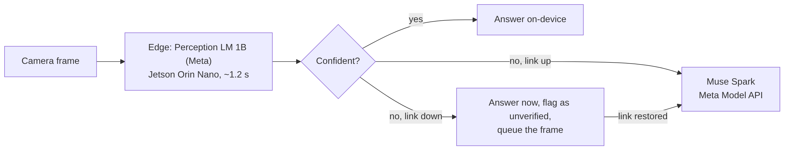
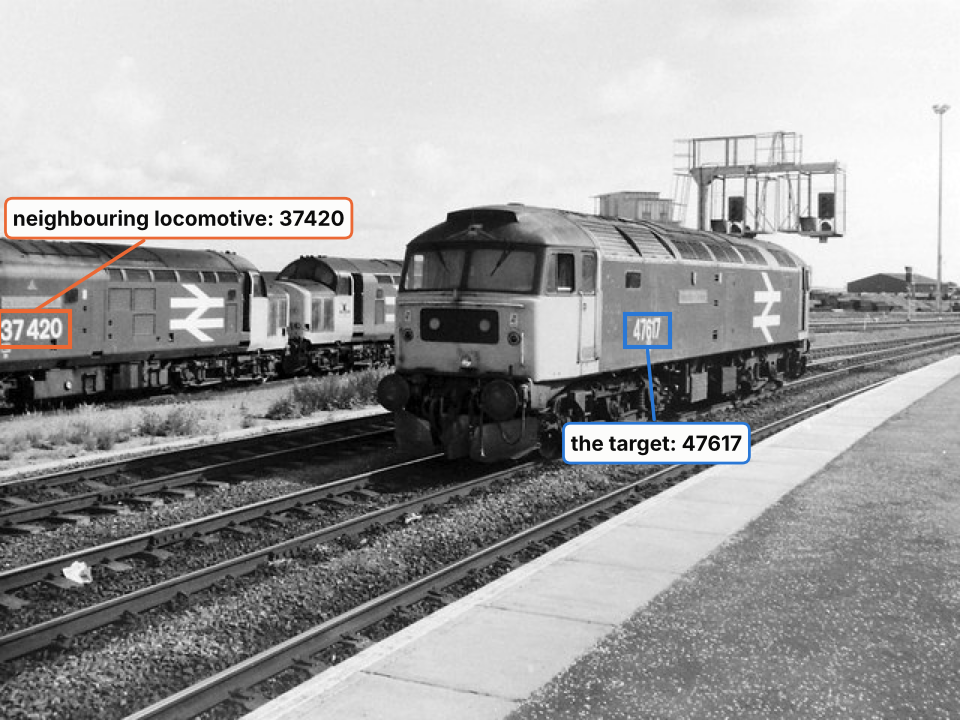
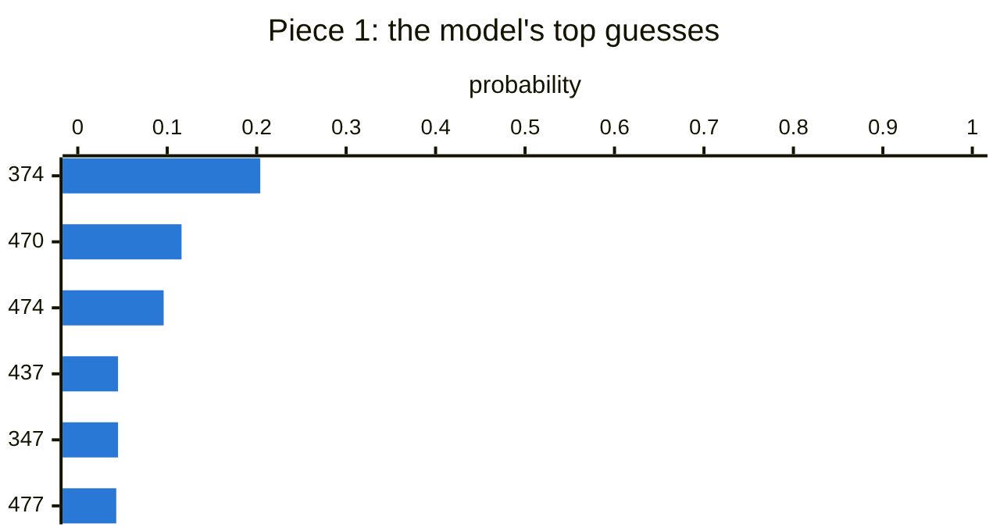
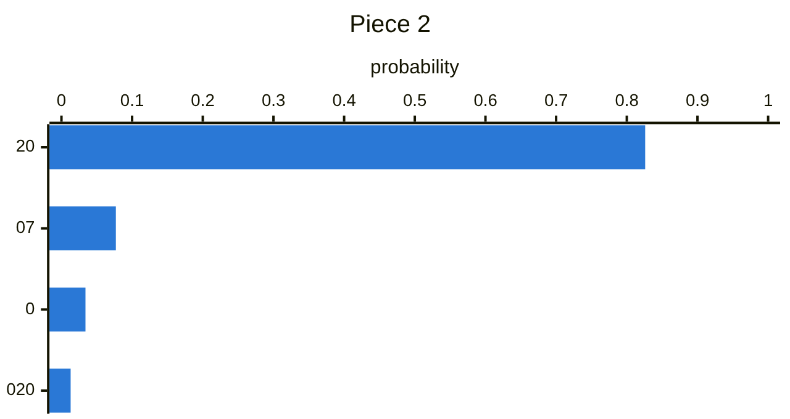
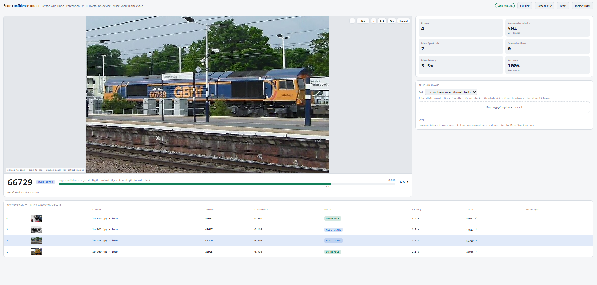

# Edge Confidence Router

**Read now, ask later: an on-device camera reader that knows when it doesn't know.**

This project is an edge-to-cloud router for reading numbers and codes from images. The ***edge*** is the device itself, with no network needed: Meta’s Perception LM 1B runs on an 8 GB Jetson Orin Nano and reads each image. It scores how sure it is from its own token probabilities, and only asks the cloud (Meta's **Muse Spark**) when it isn't sure. A read on the device takes ~1.2 s; averaged over the held-out set, including the cloud calls, a frame takes ~4.2 s. With no connection, it still answers right away, but marks the answers it isn't sure of as unverified and queues them to be checked once the connection is back: *read now, ask later.* There's no training and no fine-tuning.

**Where it could be used.** Anything that has to read short IDs where the network isn't reliable: a robot in a rail yard or plant identifying vehicles or parts, a handheld scanner at a remote site, an inspection camera in the field. It's a research prototype (the on-device model is licensed for noncommercial research only), and today it runs on the Jetson with a live dashboard fed by photos, not on a robot.

**Results in short.** On 25 locomotive photos, the router kept 9 numbers on the device, all 9 correct, with a format check catching the one confident mistake. On 25 held-out jersey photos it matched sending everything to the cloud (within noise) while answering 11 on the device. Long label codes are beyond the on-device model, so those go to the cloud.

> Built for the Meta Global AI Developer Hackathon (indie developer track), Oct–Nov 2026.

---

## How it works



**The router** decides, for every image, whether to keep the on-device answer, send the image to Muse Spark, or (with no connection) keep the answer as unverified and queue the image for later.

**The confidence signal** is what it decides with. The model writes its answer one small piece (a token) at a time, and before writing each piece it gives every possible next piece a probability. If it sees the number clearly, almost all the probability goes to one choice; if it doesn't, the probability spreads across several guesses and the one it picks scores low. The router reads those probabilities straight from the model's output, so confidence costs nothing extra: no second model, no extra pass, no training.

- **Numbers:** the router multiplies the probabilities of the digit pieces (the joint probability) and keeps the answer if it's at least **0.80**, a threshold chosen on a dev set.
- **Long codes:** multiplying many pieces would drag even a good read toward zero, so the router uses the weakest single piece instead, with a threshold of 0.90 fixed in advance.
- **Known ID formats:** if the site's IDs have a fixed format, the router also checks the answer against it (see [Locomotive numbers](#locomotive-numbers-a-known-id-format)).

### An example



*Photo: Rob Newman, CC BY-SA 2.0 (Wikimedia Commons / Geograph), annotated. This figure is also CC BY-SA 2.0.*

Asked for this locomotive's number, the edge answered **"37420"**: the number on the locomotive *next to* it. It wrote the answer in two pieces. These are its top guesses for each:

<p>
  
  
</p>

The first piece was a near tie: "374" (the neighbour) at only 0.204, with "470", "474" and "477" close behind. Those start like the real number, 47617, so the model half-saw both. **Confidence = 0.204 × 0.826 = 0.168**, below 0.80, so the frame went to Muse Spark, which read **47617**. (Data: [`results/confidence_example.json`](results/confidence_example.json).)

**What confidence can't catch** is a model that's confidently wrong, such as a dropped digit read at high confidence. That's what the format check is for, and it's why a few errors still get through on tasks without a known format.

**Custom questions.** The same router works for any short-answer question: pick **Custom…** on the dashboard or pass `--prompt` to `feed.py`. Custom prompts use the weakest-piece signal with a 0.90 threshold that no dev set chose, so their on-device answers have no tested accuracy, and the dashboard says so.

---

## The dashboard



*Four locomotive frames. The selected one (`lo_015`) scored 0.810, above the threshold, but the edge's answer "6679" failed the five-digit format check, so it went to Muse Spark, which read 66729. Photos: Wikimedia Commons, credited per image in [`data/numbers/labels.csv`](data/numbers/labels.csv) (`lo_015`: Peter Broster, CC BY 3.0).*

A web page served by the Jetson that shows the router working live. Images go in one at a time, the way a camera would send frames, and for each one it shows the answer, where it came from (**ON-DEVICE**, **MUSE SPARK**, **QUEUED**, or **QUEUED → MUSE SPARK** after sync), the confidence against the threshold with a one-line reason (for example "format check failed ('6679' is not five digits)"), and running totals.

**Cut link** simulates losing the connection, and **Sync queue** sends the queued frames to Muse Spark once it's back. The task menu switches between locomotive numbers, labels and tags, jersey numbers, or **Custom…**. You can drop in your own image, or click any row to see its frame and zoom in. Commands to start it are in [Run it](#run-it).

---

## Results

I tested the router on three sets of real photos, each with an unambiguous right answer, a range of difficulty and a license that allows this use. The author, license and link for every photo are listed in [`data/numbers/labels.csv`](data/numbers/labels.csv) (locomotives), [`data/own/ATTRIBUTION.md`](data/own/ATTRIBUTION.md) (jerseys) and [`data/labels/RUBRIC.md`](data/labels/RUBRIC.md) (labels). Jersey numbers are used purely as a test set: short printed numbers on real, often blurry or angled photos. The project is the router, not a sports tool.

### Locomotive numbers: a known ID format

A robot in a rail yard has to identify the unit in front of it from the number painted on it, and a real site knows what its IDs look like.

**The known format.** Every British Railways locomotive number is exactly five digits, with no letters, usually painted as two digits, a space, then three (for example `66 729`).
So any answer with fewer or more than five digits, or with a letter in it, can't be the right answer.

**Rule.** The prompt tells the model this format. The router keeps an answer on the device only if it has exactly five digits **and** its confidence is at least 0.80, the jersey dev threshold, not re-tuned. I committed the rule, the 25 labels and the rubric ([`data/numbers/RUBRIC.md`](data/numbers/RUBRIC.md)) before the run, and ran it once. The photos are from Wikimedia Commons (7 easy, 8 medium, 10 hard).

| Locomotive numbers (n = 25) | Result |
| --- | --- |
| Edge model alone | **16/25** correct, ~1.2 s per read |
| Kept on-device (format **and** confidence) | **9/25, all 9 correct** |
| Kept by confidence alone (for comparison) | 10/25, 9 correct, 1 wrong |
| After sync with Muse Spark | **21/25** (16 cloud calls, 2.96 MB uploaded) |

- **The format check caught the mistake confidence missed.** `lo_015` was read as "6679" (a dropped digit) at 0.810, above the threshold. Confidence alone would have kept it; the format rule sent it to the cloud, which read 66729.
- **Confidence caught the distractor** in `lo_002` (the example above).
- **All 4 final errors came from the cloud.** Muse Spark got 12 of its 16 frames right, and once overwrote a correct edge answer (`lo_001`, 47543 → 47545).

Results: [`results/plm_locomotives.json`](results/plm_locomotives.json).

### Jersey numbers: the benchmark

This is the set I used to choose the threshold and then test the router: 40 Wikimedia Commons photos, split into 15 dev and 25 held-out (see [How it was evaluated](#how-it-was-evaluated)).

| Held-out (n = 25) | Correct | Answered on-device | Cloud calls |
| --- | --- | --- | --- |
| **Confidence router** (edge, then Muse Spark if unsure) | **24/25** | **11** | 14 |
| Edge only (Perception LM 1B on the Jetson) | 22/25 | 25 | 0 |
| Muse Spark only, full image (cloud) | 22/25 | 0 | 25 |
| SAM 3.1 crop → Muse Spark (cloud) | 22/25 | 0 | 48 |

- **The router matches sending every frame to the cloud, within noise,** while answering 11 of 25 on the device (~1.2 s each) and working offline. The 24 vs. 22 gap is two photos, and the cloud-only rows come from a separate run (Nov 2) of a model whose answers vary between runs, so I don't read it as "better".
- **2 of the edge's 3 errors had very low confidence** (0.165, 0.391) and went to the cloud. One didn't: `wm_027`, read as "14" at 0.908 (truth 40), the router's only confident error.
- **The threshold is conservative.** 12 of the 14 frames sent to the cloud were already right on the edge, several just under 0.80.

**Offline, then sync** (same 25 photos, connection cut): the edge answered all 25 at ~1.2 s each, 22 correctly; 14 were flagged as unverified and queued. After sync: **23/25**. Sync fixed 2 edge errors and overwrote 1 correct edge answer (`wm_014`, "14" → "0"); 3.70 MB uploaded.

Results: [`results/plm_jersey_heldout_online.json`](results/plm_jersey_heldout_online.json), [`results/plm_jersey_heldout_offline.json`](results/plm_jersey_heldout_offline.json), [`results/plm_jersey_heldout_sync.jsonl`](results/plm_jersey_heldout_sync.jsonl).

### Labels and tags: beyond the on-device model

Tracking numbers, part numbers, bin and location codes, postal codes: 9 free-to-use photos (Pexels) of shipping labels, an inspection tag and warehouse bin labels, with the labels and rubric committed before any run.

**The on-device model couldn't read them, so none were kept on the device and all 9 went to the cloud** (7/9 correct after sync). With my first prompt, which listed the kinds of identifier to look for, the 1B model answered with the *kind* ("PART NUMBER") instead of the value. I then tried a second prompt (chosen after seeing that run, on the same 9 images, so reported separately) asking for "only the characters of the code, exactly as printed". The edge read 3 of 9 values correctly (a barcode, a part number, a postal code) and produced garbage on the long tracking labels. Every answer still scored below 0.90, so none were kept. A larger image didn't help.

Looking back at the scores, a threshold around 0.70 would have kept the 2 best correct reads and no wrong ones, but I picked 0.70 after seeing the answers, so it isn't a result. **For long codes, this model needs the cloud** (or a format rule per label type, see [Future work](#future-work)).

---

## How it was evaluated

**Labels and difficulty were set by hand before any model saw the images**, using written rules ([`data/own/RUBRIC.md`](data/own/RUBRIC.md), [`data/numbers/RUBRIC.md`](data/numbers/RUBRIC.md)): *easy* means large, sharp and facing the camera; *medium* means small, angled or with a competing number; *hard* means blur, low light, film grain, a partly hidden number or a distracting number nearby. Both number sets lean hard on purpose, so the on-device rates are on the low side.

**Dev set and held-out set.** A script split the 40 jersey photos with a fixed random seed ([`scripts/build_manifests.py`](scripts/build_manifests.py), seed `20261101`), taking the same share of each difficulty for both groups, so nobody picked which photo went where. The **dev set** (15) is the only data used to choose the threshold. The **held-out set** (25) shows how the router does on photos the threshold wasn't chosen on.

**One honest caveat about the held-out set.** The same 25 photos were used once before, in the run with the earlier Qwen model (see [Earlier comparison](#earlier-comparison-non-meta-edge-model)). The commit history shows that after that run, the jersey prompt, the threshold rule and the routing rule did not change; the only change was the switch to Perception LM 1B that the organizers required, and its threshold was chosen on the dev set only.

**The threshold rule:** the lowest value on a fixed list (`0.50 … 0.99`) at which every answer the edge would keep on the dev set is correct ([`benchmark/select_threshold.py`](benchmark/select_threshold.py)). The edge read 13 of 15 dev photos correctly, and the rule picked **0.80**, set by a single dev photo read wrongly at 0.763, so it rests on very little data. Sweep: [`results/plm_jersey_dev_threshold.png`](results/plm_jersey_dev_threshold.png).

**Fixed before each run.** I committed every threshold, rubric and label file before its test run, ran each test once, and committed the result as it came out. The commit history shows that order, and every number here comes from a committed file in [`results/`](results/).

---

## Hardware

**Running on constrained hardware is the point.** A robot can't carry a workstation, so the reader has to fit the kind of small, low-power board robots actually use: a **Jetson Orin Nano Super Developer Kit** with a 6-core Arm Cortex-A78AE CPU, a 1024-core NVIDIA Ampere GPU and **8 GB of memory shared by the CPU and GPU**, in a 7–25 W power budget.

**A regular laptop would be easier.** A laptop with its own NVIDIA graphics card has separate GPU memory, so none of the memory problems below would come up. The code expects an NVIDIA GPU on Linux, so a laptop like that should run it unchanged; other laptops would need small changes. I haven't tested either: every result here comes from the Jetson.

**Edge model:** [`facebook/Perception-LM-1B`](https://huggingface.co/facebook/Perception-LM-1B) at commit `2b1a854`, ~1.5B parameters, bf16, run in-process with Hugging Face transformers ([`router/edge_model.py`](router/edge_model.py)). Weights SHA-256: `bc606ce0cf9fcbcd9b5b133d017cb46abb088877cb28aac6382369faab5926f8`.

**The memory problem.** On the Jetson, GPU memory comes out of system RAM, and allocations fail (`NvMap … error 12`) rather than free up the file cache. Two changes made the model load and run reliably: loading the weights straight onto the GPU (`device_map="cuda"`) instead of through the CPU, which briefly needs two copies; and evicting the weights file from the file cache after loading (`posix_fadvise`), so ~3 GB of cached pages don't block later GPU allocations.

**Speed and memory.** Warm reads take **~1.2 s** at ~3.1 GB peak GPU memory (4 tiles of 448 px per image); loading takes ~9 s. Mean routed latency on the held-out set is ~4.2 s, mostly cloud calls.

---

## Meta models used

- **Perception LM 1B** (`facebook/Perception-LM-1B`, FAIR Noncommercial Research License): the on-device reader and the source of the confidence signal, in the live path for every frame.
- **Muse Spark** (`muse-spark-1.3`, Meta Model API): the cloud tier, for every low-confidence frame and every queued frame on sync.
- **SAM 3.1** (`sam-3.1`, Meta Model API): evaluated as cloud-side localization. It found the number in 23 of 25 held-out jersey photos and every label; SAM 3.1 crop → Muse Spark scored 22/25, no better than Muse Spark alone.
- **SAM 2.1** (open weights, on the Jetson): evaluated as a crop-then-read step with the earlier edge model. Cropping made reading worse on jerseys and labels, so I dropped it.
- **SAM 3** (open weights, gated): built and run on the Jetson for feasibility only (~1.2–1.4 s per image, ~4 GB), with random weights while my access request is pending. Notes: [`experiments/sam3_local/NOTES.md`](experiments/sam3_local/NOTES.md).

**Access and licenses.** Perception LM 1B is gated on Hugging Face; Meta approved my access on Nov 3. Using it means accepting the FAIR Noncommercial Research License, so this is a research prototype, the weights are not in this repo, and the code downloads them on first run.

**Cloud cost.** Every Meta Model API call made during the project cost $2.17 in total. That covers the Muse Spark reads and syncs in every test run, the SAM 3.1 experiments, the dashboard tests and the demo rehearsals. Reads on the device cost nothing per use.

---

## Run it

**Setup** (Jetson Orin Nano 8 GB, JetPack 6, Python 3.10). pip's default aarch64 PyTorch is CPU-only, so install the CUDA build first (I used torch 2.11.0, CUDA 12.6):

```bash
git clone https://github.com/TejasD-web/edge-confidence-router.git
cd edge-confidence-router
python3 -m venv .venv && source .venv/bin/activate
pip install torch torchvision --index-url https://pypi.jetson-ai-lab.io/jp6/cu126

pip install -r requirements.txt
hf auth login                 # after requesting access at huggingface.co/facebook/Perception-LM-1B
cp .env.example .env          # add MODEL_API_KEY=... for the cloud tier (offline mode needs no key)
```
**If `import torch` fails with `libcudss.so.0: cannot open shared object file`:** the Jetson PyTorch build looks for cuDSS as `libcudss.so.0`, but the pip package ships `libcudss.so.1`. Install only cuDSS (its dependencies include a cuBLAS build that doesn't run on the Jetson GPU), link the old name, and keep the system CUDA libraries first:

```bash
pip install --no-deps nvidia-cudss-cu12
L=$(python -c "import site; print(site.getsitepackages()[0])")/nvidia/cu12/lib
ln -sf libcudss.so.1 "$L/libcudss.so.0"
export LD_LIBRARY_PATH=/usr/local/cuda/lib64:$L:$LD_LIBRARY_PATH
```

The model (~3 GB) downloads on first run, pinned to commit `2b1a854`. Meta approves access manually, which can take time.

**The dashboard:**

```bash
uvicorn server.app:app --host 0.0.0.0 --port 8000
# open http://<jetson-ip>:8000, or tunnel: ssh -N -q -L 8000:localhost:8000 <jetson>

# in another terminal, feed images like a camera would:
python server/feed.py data/numbers/images/ --task loco --manifest data/numbers/labels.csv --delay 2
python server/feed.py data/labels/images/ --task label --manifest data/labels/labels.csv --delay 2
python server/feed.py data/own/images/ --manifest data/own/labels.csv --delay 2
python server/feed.py img.jpg --prompt "Read the number on the gauge. Reply with only the number."
```

**Reproduce the numbers** (on the Jetson):

```bash
python benchmark/select_threshold.py --manifest data/own/dev.json --image-dir data/own/images   # threshold
python router/route.py --manifest data/own/heldout.json --image-dir data/own/images             # held-out
python router/route.py --clear-queue                                                             # offline, then sync
python router/route.py --manifest data/own/heldout.json --image-dir data/own/images --max-tier 1
python router/route.py --sync
python benchmark/number_test.py                                                                  # locomotives
python benchmark/label_test.py                                                                   # labels
```

**Check the results without a Jetson.** Every run's per-image answers and confidences are in `results/`. To re-apply the threshold rule to the committed dev-set run without the model:

```bash
python benchmark/select_threshold.py --from-json results/plm_jersey_dev_threshold.json --no-config
```

Edge answers are deterministic (greedy decoding); Muse Spark answers can vary between runs.

**Add your own ID format.** Tasks live in [`router/task_route.py`](router/task_route.py). To support another fixed ID scheme, add a task with its prompt, a threshold and a `format` pattern, as the `loco` task does; the router then keeps an answer on the device only if it matches the format and clears the threshold.

### Repo layout

```text
router/       edge_model.py (on-device model), route.py (jersey router, offline queue, sync),
              task_route.py (labels, locomotives, custom prompts), meta_client.py (Muse Spark, SAM 3.1)
server/       app.py (dashboard API), static/index.html (dashboard page), feed.py (sends images)
benchmark/    select_threshold.py, number_test.py, label_test.py, cloud_sam_test.py, ...
data/         own/ (jerseys), numbers/ (locomotives), labels/ (labels): images, labels, rubrics, credits
results/      every committed run
config/       threshold.json (the frozen 0.80)
docs/         README figures (PNG) and their sources (.mmd charts, figure script)
```

---

## Earlier comparison (non-Meta edge model)

Until Nov 3 the on-device reader was Qwen2.5-VL-3B-Instruct (4-bit, llama.cpp). The organizers ruled that every model a project calls at runtime must be a Meta model, so I switched to Perception LM 1B. **Qwen is not part of the submitted project, and no code in this branch calls it.** Its results are kept for comparison because they came from the same data and rules; the code is at git tag [`qwen-comparison`](https://github.com/TejasD-web/edge-confidence-router/tree/qwen-comparison).

| Same pipeline, same data | Qwen2.5-VL-3B (non-Meta, 4-bit) | **Perception LM 1B (Meta, bf16)** |
| --- | --- | --- |
| Dev: edge accuracy / chosen threshold | 6/15 / 0.85 | **13/15 / 0.80** |
| Held-out: edge only | 12/25 | **22/25** |
| Held-out: router | 23/25 | **24/25** |
| Held-out: answered on-device | 3/25 | **11/25** |
| Held-out: confident errors | 1 | 1 |
| Held-out: cloud calls | 22 | **14** |
| Labels (first prompt): edge / kept / after sync | 2/9 / 0 / 8/9 | 0/9 / 0 / 7/9 |

The smaller Meta model read jersey numbers much better and let the router keep almost 4× as many frames on the device.

---

## Limits

- **Small test sets.** 25 held-out jersey photos, 25 locomotive photos and 9 label photos; one photo moves a result by 4 points. Treat the numbers as evidence of behavior, not precise rates.
- **The jersey threshold rests on one dev photo** (0.763). A different dev set could have given a different threshold.
- **Confident errors get through without a format check.** `wm_027` was kept at 0.908 ("14", truth 40); offline, nothing can catch it.
- **The format check needs a known format,** and a wrong number in the right format (the neighbouring locomotive's, say) still needs low confidence to be caught.
- **Long codes are beyond the on-device model;** labels go to the cloud.
- **The router trusts the cloud.** Muse Spark varies between runs, and on sync it overwrote correct edge answers twice (`wm_014`, `lo_001`).
- **Custom prompts are uncalibrated;** only the jersey threshold was chosen on a dev set.
- **Research use only.** Perception LM 1B is licensed for noncommercial research, so this is a prototype. It reads numbers; it doesn't control a vehicle or make safety decisions.

---

## Future work

- **Run on a robot:** mount the Jetson and camera on a mobile robot and feed live frames instead of photos.
- **Don't blindly trust the cloud:** when the edge was fairly confident and the cloud disagrees, flag the frame instead of overwriting the edge answer.
- **Format and check-digit rules for labels,** one per label type; many formats carry their own checksum (EAN-13 barcodes, UPU tracking numbers like `EC…US`), which the device could verify offline.
- **A length-aware threshold for long codes,** chosen on a fresh dev set of labels.
- **SAM 3 / 3.1 on the Jetson with real weights,** measuring accuracy, not just speed.

---

## About this project

I built this during the hackathon (Oct 26 – Nov 4, 2026): the router, the evaluation, offline mode and sync, the dashboard, the SAM 2.1 setup, and every experiment here. The one thing that came before is the Jetson's base setup from an earlier project: JetPack, a llama.cpp build of Qwen2.5-VL-3B, and a profiling run of it. I first built and tested the router on that Qwen setup, then switched to Perception LM 1B and reran every test.

I used Claude (Anthropic) for help with coding, debugging, and research.

---

## Credits and licenses

- **Perception LM 1B:** Meta, FAIR Noncommercial Research License ([license](https://huggingface.co/facebook/Perception-LM-1B/blob/main/LICENSE)); used for noncommercial research. Cho et al., *PerceptionLM: Open-Access Data and Models for Detailed Visual Understanding*, 2025.
- **Hugging Face transformers:** Apache 2.0. **SAM 2.1:** Apache 2.0. **SAM 3:** SAM License (Meta). **Muse Spark and SAM 3.1:** Meta Model API terms.
- **Earlier comparison only** (not part of the submitted project): Qwen2.5-VL-3B-Instruct under the Qwen RESEARCH LICENSE AGREEMENT, Copyright (c) Alibaba Cloud; llama.cpp (MIT).
- **Images:** Wikimedia Commons (public domain, CC0, CC BY, CC BY-SA) and Pexels (Pexels License), credited per image in the files linked under [Results](#results). Images were downloaded at reduced resolution and converted to JPEG where needed; `lo_016` and one other photo (noted in its rubric) were cropped. The figure in [How it works](#an-example) is an annotated CC BY-SA 2.0 photo by Rob Newman, shared under the same license. Inclusion does not imply endorsement by the photographers or the people pictured.
